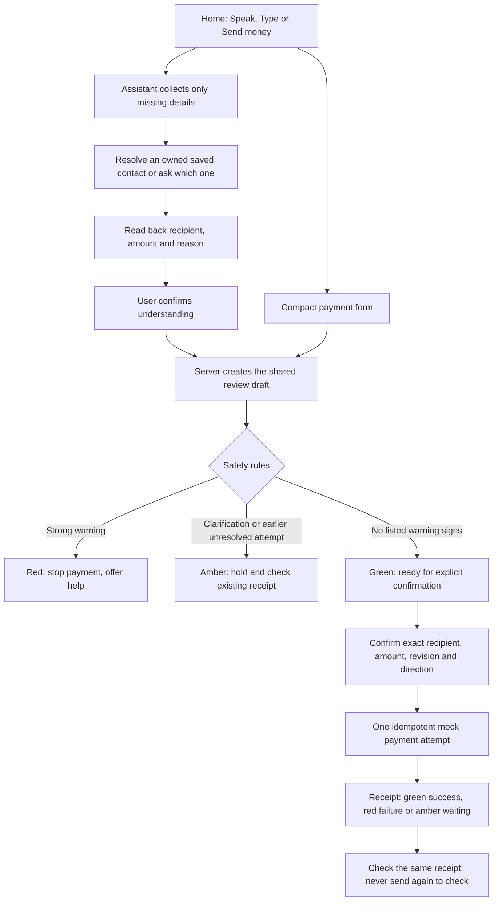

# Workflow and architecture map

Reviewed and refined on 15 October 2026. All payment, bill and telephone outcomes remain simulations.

## Main journey

Green means ready for the next confirmation step. It does not establish a bank-verified identity or guarantee that a request is safe. No rule-based system can detect every scam.

## Route responsibilities

| Area | Routes | Ownership and handoff |
| --- | --- | --- |
| Main entry | `/`, `/assistant` | Distinct green microphone and blue typing panels; editable transcript; explicit Send; native questions and saved-contact matching. |
| Payment | `/send-money`, `/payment-result/[id]`, `/activity` | Server-owned draft, sticky warnings, fresh confirmation, durable request ID and one receipt. Restores the current form after navigation. |
| Destinations | `/recipients`, `/qr`, `/familiar-tasks` | Fictional Akash/Suraj/Gowtham samples, editable UPI/mobile, owner-bound contact IDs; QR and recent tasks prepare details, never approve a transfer. |
| Bills | `/bills` | Retrieve and bind a fictional bill, then open shared review directly. Biller acknowledgement remains separate from the payment result. |
| Safety and support | `/help`, `/help/fraud`, `/help/complaint`, `/contacts` | Check suspicious requests, prepare incident drafts from owned evidence, call a trusted contact, or hand off to official support. Draft readiness is explicit. |
| Telephone demo | `/keypad` | Pair once, authenticate each call with an app-only code, choose a saved recipient, enforce ₹10,000 limit, then use the same review/receipt safeguards. |
| Guides and practice | `/services`, `/services/[id]`, `/learn`, `/controls`, `/glossary`, `/reading` | Primary guides separated from optional tools. English/Hindi/Kannada service guides. Reading requires consent and does not create a payment. |
| Personal continuity | `/reminders`, `/settings`, `/onboarding`, `/account`, `/trusted-help` | Preferences, owned reminders and account isolation. A shared help guide grants no payment control. |

## Code boundaries

- `frontend/src/components/app-shell.tsx`: shared navigation, language and serialized preference writes. Connection failures use amber recovery; preferences are restored after a failed save.
- `frontend/src/lib/voice.ts`: speech output, consented recording and transcription. `recognition.ts` controls native recognition lifecycle separately: confirmed startup, partial words, late final words, cancellation and bounded silence/startup.
- `backend/conversation.py` and `payment_contacts.py`: conversational state and exact/known-alias resolution against the current owner's records. Ambiguous contacts require an explicit choice. English/Hindi/Kannada aliases do not invent a destination.
- `backend/payments.py` and `safety.py`: authoritative safety and confirmation. Browser prefill and AI interpretation cannot authorize payment. Contact details are checked again at review, confirmation and execution.
- `backend/storage.py` and `identity.py`: durable, owner-scoped records and opaque browser sessions. Private API responses are not cached by the service worker.
- `backend/fraud_assistant.py`: incident evidence and missing facts. Reuse requires matching receipt/conversation sources and unchanged context; a deleted incident is not revived.
- `backend/phone_assistant.py`: simulated calls and the signed adapter interface. No carrier or bank is connected.

## Important recovery paths

| Problem | Result |
| --- | --- |
| Backend stopped / proxy returns 500 | Connection message rather than a false validation error; current fields remain; retry after service recovery. `Start-EasyPay.ps1` starts and checks both services. |
| Browser exposes recognition but never starts | “Starting microphone” with cancellation, then a bounded error and explicit online voice choice. It never claims to be listening before startup. |
| Recognition starts but returns no words | Stops after 15 seconds without words and offers retry/online voice/typing; reports permission, device and network failures separately. |
| Saved contact changed or removed | Old details cannot be confirmed or executed; choose the current contact again. Replaying an already completed request still retrieves its receipt. |
| Lost response after payment | Persist and replay the same request ID; do not create a replacement attempt. |
| Fraud plus an unresolved earlier payment | Keep the strong red warning and link the earlier receipt; duplicate detection cannot downgrade fraud severity. |

## Remaining product validation

Physical microphone/voice quality and task comprehension require testing with older English, Hindi and Kannada speakers. Some supporting account, lesson and manual-report prose still needs translation. Manual incident drafts need a fuller edit/resume experience. Live bank authorization, carrier calling and official complaint submission require authorized external partners and are not implied by this demo.
